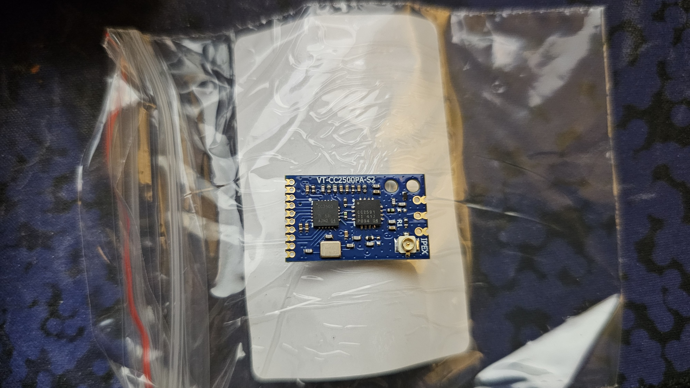
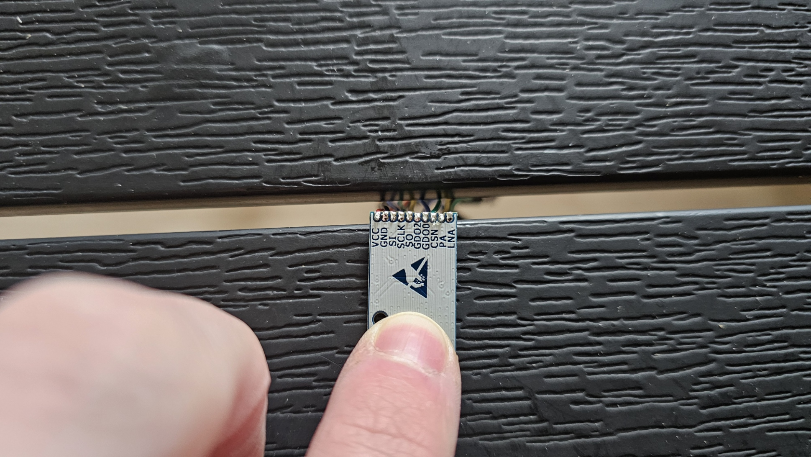

# Hardware

## What I used

| Part | What I used it for |
|---|---|
| 3x ESP32-S3-DevKitC-1 (N16R8) | one board per radio module |
| VT-CC2500PA-S2 (TI CC2500 + CC2591 PA/LNA, 26 MHz crystal) | the transmitter, and later as a raw receiver to capture the remote's preamble |
| nRF24L01+PA+LNA (clone) | receiver for capturing frames and recording the buttons |
| XL7105-SY-B (AMICCOM A7105) | tried as a receiver, but it never decoded the remote |
| VS Code + PlatformIO | building and flashing everything |

Some things I ran into with these parts:

- On my VT-CC2500PA-S2 the PA and LNA pins are swapped compared to the module's guide. For me
  TX is PA high / LNA low and RX is LNA high / PA low. I never drive both high at the same time.
- My nRF24 module is a clone and needs bit 0 of RF_SETUP kept set.
- On the ESP32-S3 I stayed away from GPIO 35-37 (PSRAM), 0/3/45/46 (strapping pins) and
  19/20 (USB).
- The A7105 found the signal in an RSSI scan but couldn't demodulate it. My guess is that the
  remote's deviation is too wide for its IF filter.

## Wiring

### Transmitter (ESP32-S3 to VT-CC2500PA-S2)

  
  

<em>The VT-CC2500PA-S2: CC2500 and CC2591 on top, pin labels on the back.
I soldered wires straight onto the castellated pads.</em>

| CC2500PA pad | ESP32-S3 |
|---|---|
| VCC | 3V3 |
| GND | GND |
| SI | GPIO11 |
| SCLK | GPIO12 |
| SO | GPIO13 |
| CSN | GPIO10 |
| GDO0 | GPIO4 |
| GDO2 | GPIO5 |
| PA | GPIO6 |
| LNA | GPIO7 |

I run it at `PATABLE 0x60`, which is enough to reach the lamp from the next room. Full power
(`0xFE`) wasn't needed.

### Receiver (ESP32-S3 to nRF24L01+)

| nRF24 | ESP32-S3 |
|---|---|
| VCC | 3V3 (not 5 V) |
| GND | GND |
| CE | GPIO9 |
| CSN | GPIO10 |
| SCK | GPIO12 |
| MOSI | GPIO11 |
| MISO | GPIO13 |
| IRQ | GPIO14 |

## Cheaper radios I tried

To just control the lamp I only use the ESP32 and the CC2500 module now. The receiver boards
were only for figuring out the protocol. Afterwards I tried whether a cheaper radio could do the
transmitting too. Both transmitted fine, and the lamp ignored both.

- nRF24L01+. The nRF24 always sends a one-byte preamble (`AA` when the address starts with
  a 1 bit) and an address of up to 5 bytes. With the address set to `CC CC CC CC B9` and the
  payload `A1 99` + the 17-byte frame (CRC off, 250 kbps), the packet is byte for byte the
  remote's, sent with the same timing. The lamp never reacted. My best guess is the frequency
  deviation: the nRF24 shifts about ±160 kHz at 250 kbps, while the remote uses around
  ±250 kHz and my working CC2500 setup uses about ±280 kHz.
- A7105 (XL7105-SY-B). Same idea: 4-byte preamble, ID code `CC CC CC CC`, payload
  `B9 A1 99` + frame, no CRC/FEC/whitening, same timing. I ran an automatic sweep of 52 single
  On/off taps: normal, inverted and LSB-first bits, each with 13 different deviation settings.
  None of them did anything. I couldn't get hold of a readable datasheet, so the deviation
  settings were partly guesswork, but together with the A7105 never being able to receive the
  remote either, I think it just can't produce a wide enough deviation.

The test sketches are in [`tools/nrf24-transmitter-test`](../tools/nrf24-transmitter-test) and
[`tools/a7105-transmitter-test`](../tools/a7105-transmitter-test).

Things I haven't tried:

- A plain CC2500 module without the PA. It's the same chip and the same code, just without the
  PA/LNA pins, so it should work. The original remote only has a small PCB antenna, so I expect
  the range to be fine. I have one, but haven't wired it up.
- A smaller ESP32 like an ESP32-C3 SuperMini. Any ESP32 with SPI and Wi-Fi should do.

An RTL-SDR won't help here since it only goes up to around 1.7 GHz. A HackRF would have worked,
but in the end I didn't need one.

## Radio rules

This is a low power device on the 2.4 GHz band. I keep the power as low as works, only transmit
when a button is pressed, and never transmit without the antenna connected. In the EU the limit
for this kind of device is around 10 mW EIRP.
