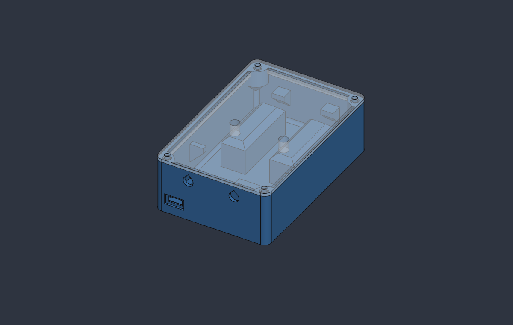
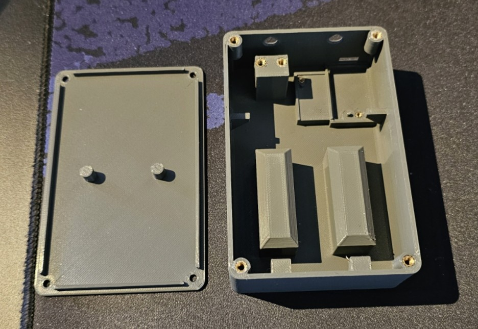
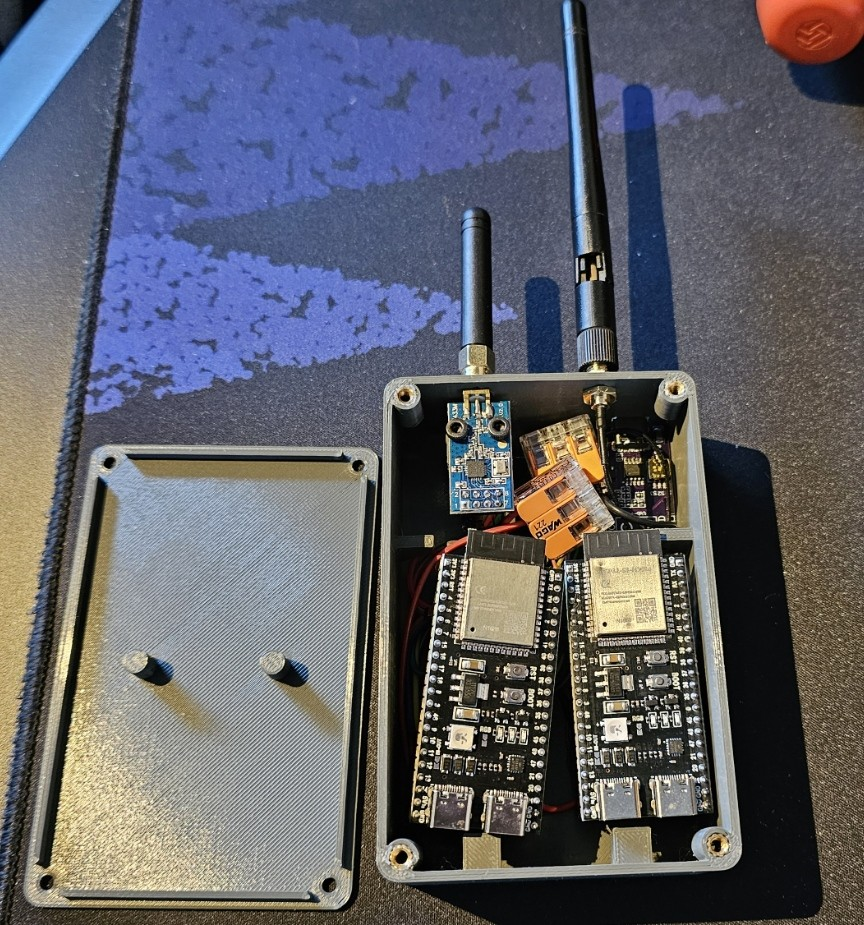
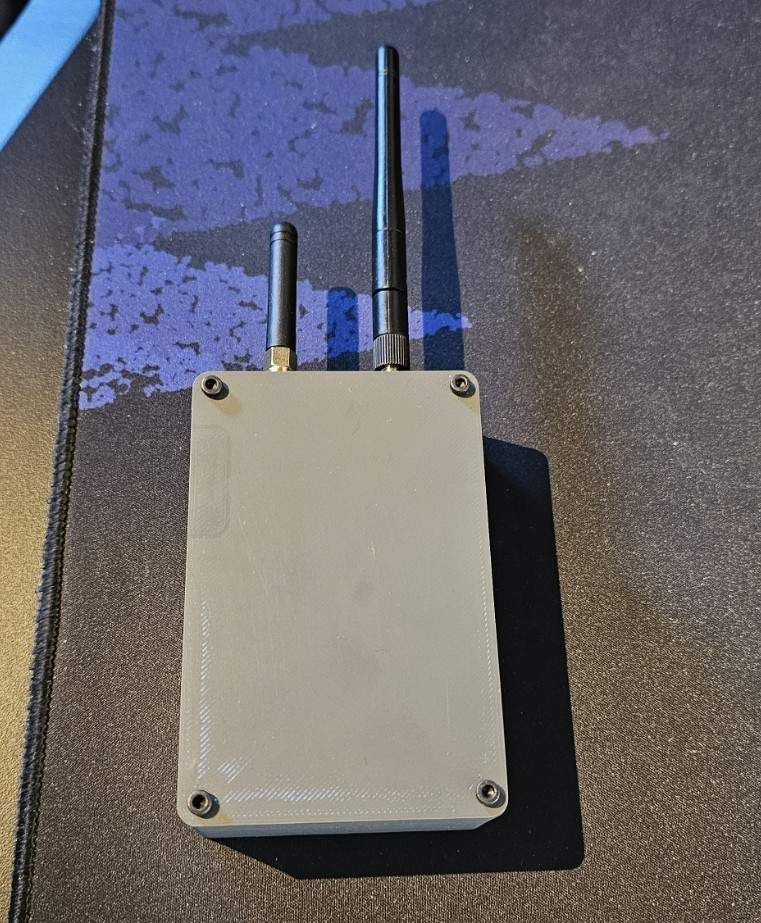

# Enclosure

A 3D-printed box (112 x 74 x 36 mm) for the finished transmitter. It holds two ESP32-S3-DevKitC-1
boards, the VT-CC2500PA-S2 module, a CC1101 433 MHz module and a USB-C PD trigger board for power.
All connectors are on the back: the two SMA antennas side by side and the USB-C power input.

  

This box is built for my own setup, which is a bit niche: it controls more than just this lamp
(the lights and my curtains), which is why there are two ESP32s and a second radio. You probably
don't need all of that. Feel free to use it as a starting point for your own enclosure instead.
The SolidCraft source is parametric, and the board mounts, wall stubs, screw pillars and test
prints are easy to reuse or remove.

Designed in SolidCraft. Everything prints without supports, and I checked all the fits with the
small test prints in [test_prints](test_prints) before printing the full box.

## Files

| File | What it is |
|---|---|
| `enclosure_base.stl` | The box. Print as is, floor down. |
| `enclosure_lid.stl` | The lid. Flip it so the flat top is on the bed. |
| `enclosure_assembly.step` | Base, lid and simple placeholder boards, for other CAD programs |
| `radio_enclosure.sc` | The parametric SolidCraft source |
| `test_prints/` | Fit-test pieces and how to use them ([TEST_PRINTS.md](test_prints/TEST_PRINTS.md)) |

## What goes where

| Part | How it's held |
|---|---|
| 2x ESP32-S3-DevKitC-1 | On pedestals 20 mm above the floor (room for header pins and Dupont plugs underneath), held between small stubs on the walls. The two posts on the lid press them down. |
| VT-CC2500PA-S2 (CC2500 + CC2591) | In a shallow pocket. One M2 screw through one of its mounting holes and a printed peg in the other. The IPEX pigtail goes to an SMA bulkhead in the back wall. |
| CC1101 (433 MHz, with SMA) | Two M3 screws through its own mounting holes into a pedestal. The SMA goes straight through the back wall. |
| USB-C PD trigger board | In a pocket, with a printed peg in the 3V3 output hole and an M2 screw in the GND hole. The USB-C socket lines up with the opening in the back wall. Set the DIP switches to **5 V** before connecting anything. |

  
  
  

<em>The printed base and lid with the inserts melted in, everything fitted, and the
closed box.</em>

The ESP32's own USB ports are not reachable when the box is closed, so update the firmware over
the air (ESPHome does this).

## Hardware

- 6x M3 heat-set inserts (hole 4.0 mm) and 6x M3x12 screws: 4 for the lid, 2 for the CC1101
- 2x M2 heat-set inserts (hole 3.2 mm) and 2x M2x6 screws: CC2500 and PD board
- 1x IPEX/U.FL to SMA bulkhead pigtail and 2x 2.4 GHz / 433 MHz antennas

The base is about 100 g of PLA at 100 % infill and the lid about 24 g, so less with normal infill.

## Printing notes

- The floor is closed under every screw hole.
- The lid screw pillars in the corners have a 45° cone underneath that grows out of the walls,
  and the SMA holes have a teardrop top, so nothing needs support.
- Every fit has at least 0.1 mm of clearance (the lid lip has 0.3 mm per side), except the ESP32
  stubs, which are 0.0 mm on purpose so the boards sit snugly.

## Changing it

`radio_enclosure.sc` is fully parametric. The main parameters are the box size (`IX`, `IY`, `IZ`,
`wall`), the pedestal height (`ped_h`), the antenna height and spacing (`ant_z`, `ant_dy`), the
board measurements (`pd_*`, `cc11_*`, `cc25_h`) and the print clearance (`fit`, `clr`). The test
prints are cut from the same model, so they follow any change.
