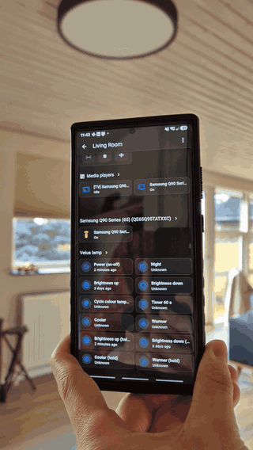

# ESPHome version

This is the same transmitter as `firmware/velua-transmitter`, but as an ESPHome device so it
shows up in Home Assistant. The radio code lives in `components/velua_remote` as an external
component, and `velua-bridge.yaml` is the device config.

## What shows up in Home Assistant

- A button for each of the 8 remote buttons (a normal short tap)
- "(hold)" buttons for brightness up/down and cooler/warmer, which keep the button pressed for
  the number of seconds set in "Hold time"
- A "Hold time" number (0.5 to 5 s)
- An action, `esphome.velua_bridge_press`, with `button_number` (1-8) and `duration_ms`
  (100 is a tap), for use in scripts and automations

<p align="center">
  
</p>

The lamp never sends anything back, so there is no on/off state in Home Assistant. The buttons
just do what the remote buttons do.

Each button press blocks the ESP32 for about 1.7 s (longer for holds) while it transmits.
Presses that come in during that time are handled afterwards. Between presses the CC2500 is
put to sleep and the PA is switched off.

## How I set it up

1. Copy `secrets.example.yaml` to `secrets.yaml` and fill in the Wi-Fi details, an API key
   and an OTA password.
2. First flash over USB:
   ```
   esphome run velua-bridge.yaml
   ```
3. In Home Assistant the device is discovered under Settings > Devices & services. It asks
   for the API encryption key from `secrets.yaml`.
4. Later updates can go over Wi-Fi with the same `esphome run` command.
